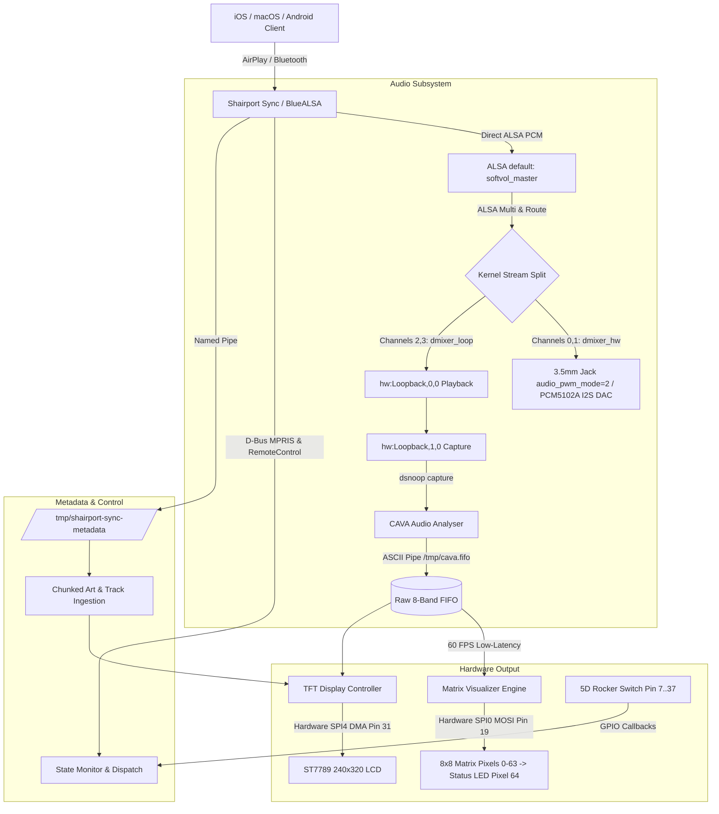

# Sandy's AirPlay Device — Comprehensive Technical Documentation
**High-Fidelity Audio Receiver, ST7789 TFT Display Engine & Fluid LED Visualizer**

---

## 1. Executive Summary

**Sandy's AirPlay Device** is an audiophile-grade, low-latency wireless audio receiver and dynamic multimedia controller built for the Raspberry Pi. It integrates high-definition audio reception with real-time hardware visualizations and physical controls:

* **Audio Streaming:** Bit-perfect AirPlay (via `shairport-sync` 4.x) and Bluetooth A2DP audio with ALSA Loopback decoupling (`snd-aloop`) and multi-card `SoftMaster` volume attenuation.
* **TFT Display Subsystem (ST7789 2.8" 240×320):** Hardware SPI4 driver executing at 32 MHz with <1ms frame rendering, Apple SF Pro typography, dynamic marquee scrolling, Apple-style monotonic progress bar, and 6 switchable display modes (including album art, fluid ribbon oscilloscope, halo spectrum with rotating vinyl dial, and 3D warp tunnel).
* **Fluid 8×8 WS2812B Matrix Visualizer:** 60 FPS real-time audio visualizer utilizing 2D "Soap Bubble" pastel iridescent color blending, horizontal spatial pre-diffusion for paper diffusers, viscous fluid dynamics with surface tension coupling, and ballistic gravity-driven pearl peak droplets.
* **Dedicated Status Indicator:** Single WS2812B LED daisy-chained off the matrix DOUT pin displaying connection and playback states without consuming extra GPIO pins.
* **5D Rocker Switch Controls:** Tactile physical media navigation with single-dispatch D-Bus routing and 0ms optimistic UI feedback.

---

## 2. System Architecture & Data Flow



---

## 3. Hardware Wiring Reference & GPIO Header Map

All hardware modules share the standard 40-pin Raspberry Pi GPIO header.

### 3.1. Master 40-Pin Header Allocation Table

| Physical Pin | BCM GPIO | Signal / Hardware Function | Target Device & Wire Color | Hardware Role |
| :---: | :---: | :--- | :--- | :--- |
| **Pin 1** | **3V3** | 3.3V DC Power Rail | **ST7789 VCC** (🔴 Red) | Display logic supply |
| **Pin 6** | **GND** | System Ground | **ST7789 GND** (🟤 Brown) | Common display ground |
| **Pin 7** | **GPIO 4** | GPIO Input (Pull-Up) | **Rocker RST** (🟠 Orange) | Hold 1s for AirPlay ↔ BT toggle |
| **Pin 11** | **GPIO 17** | GPIO Input (Pull-Up) | **Rocker DOWN** (🔘 Grey) | Volume Down (-5% SoftMaster) |
| **Pin 13** | **GPIO 27** | GPIO Input (Pull-Up) | **Rocker SET** (🟡 Yellow) | Cycle 6 Display Modes (0..5) |
| **Pin 14** | **GND** | Digital Ground | **Rocker COM** (⚫ Black) | Joystick common ground |
| **Pin 15** | **GPIO 22** | GPIO Input (Pull-Up) | **Rocker LEFT** (🟣 Purple) | Previous Track |
| **Pin 16** | **GPIO 23** | GPIO Input (Pull-Up) | **Rocker RIGHT** (🔵 Blue) | Next Track |
| **Pin 18** | **GPIO 24** | GPIO Output | **ST7789 DC** (🟢 Green) | Data / Command register select |
| **Pin 19** | **GPIO 10** | **SPI0 MOSI** | **8×8 Matrix DIN** (🔵 Blue) | High-speed LED serial data stream |
| **Pin 22** | **GPIO 25** | **SPI4 CS0** | **ST7789 CS** (🟠 Orange) | Dedicated LCD chip select |
| **Pin 26** | **GPIO 7** | **SPI4 SCLK** | **ST7789 SCK** (🟣 Purple) | Hardware 32 MHz SPI clock |
| **Pin 31** | **GPIO 6** | **SPI4 MOSI** | **ST7789 SDI** (🔵 Blue) | Hardware SPI data out |
| **Pin 32** | **GPIO 12** | GPIO Output | **ST7789 RESET** (🟡 Yellow) | Hardware display reset |
| **Pin 36** | **GPIO 16** | GPIO Input (Pull-Up) | **Rocker UP** (⚪ White) | Volume Up (+5% SoftMaster) |
| **Pin 37** | **GPIO 26** | GPIO Input (Pull-Up) | **Rocker MID** (🟢 Green) | Play / Pause Toggle |
| **Pin 38** | **GPIO 20** | GPIO Output | **ST7789 LED** (⚪ Grey) | LCD Backlight control (Active-High) |
| **Pin 39** | **GND** | Common Ground | **Matrix & PSU GND** (⚫ Black)| Essential common reference ground |

---

## 4. WS2812B 8×8 Matrix & Dedicated Status LED Subsystem

### 4.1. Daisy-Chain Architecture
The 8×8 Matrix and single Status LED are unified into a single 65-pixel daisy chain driven over **SPI0 MOSI (GPIO 10 / Pin 19)**:

```text
Raspberry Pi Pin 19 (GPIO 10 / SPI0 MOSI)
       │
       ▼
┌─────────────────────────────────┐
│     8×8 Matrix LED Plate        │  Pixels 0–63 (64 LEDs)
│  (DIN on Pin 19 / GPIO 10)      │  Progressive column mapping (Col 0..7, bottom → top)
│             DOUT                │
└──────────────┬──────────────────┘
               │
               ▼
┌─────────────────────────────────┐
│    Single WS2812B Status LED    │  Pixel 64 (1 LED)
│  (DIN attached to Matrix DOUT)  │  AirPlay / Bluetooth status indicator
└─────────────────────────────────┘
```

### 4.2. "Soap Bubble" Iridescent Aesthetics for Paper Diffusers
The visualizer completely avoids harsh green/red traffic light color schemes in favor of an organic, iridescent "Soap Bubble" palette. When viewed through a paper diffuser, the light scatters as a continuous milky sheen.

* **Lightened Pastel Color Nodes (High-Luminance Baseline $\ge 90$ counts):**
  1. **Soft Light Lavender / Periwinkle:** `(180, 130, 255)`
  2. **Luminous Ice Cyan / Aqua:** `(90, 235, 255)`
  3. **Ethereal Soft Violet / Lilac:** `(175, 140, 255)`
  4. **Glowing Rose Orchid / Pastel Magenta:** `(255, 125, 195)`
  5. **Warm Luminous Peach / Soft Apricot:** `(255, 195, 145)`
  6. **Champagne Blush / Pastel Pink:** `(255, 160, 215)`

* **Continuous Drifting Color-Wheel Phase:**
  The color coordinates drift smoothly over time across the 360° chromatic circle:
  $$\phi = (\text{phase} + 0.28 u + 0.22 v + 0.06 \sin(2.0 u - 1.4 v)) \pmod{1.0}$$
  `phase` advances continuously ($+0.0012$ per frame, accelerating to $+0.0030$ on beat transients), cycling through the entire iridescent spectrum every ~15 seconds.

* **Horizontal Spatial Pre-Diffusion (Software Column Merging):**
  To ensure adjacent columns seamlessly merge through paper diffusion, a 3-tap bilateral spatial filter is computed before writing to hardware:
  $$C_{\text{merged}}[c, r] = 0.70 \cdot C[c, r] + 0.15 \cdot (C[c-1, r] + C[c+1, r])$$
  This pre-bleeds column colors into their neighbors in software, transforming separate LED bars into a cohesive liquid entity.

* **Soft Meniscus Sub-Pixel Dithering:**
  Boundary LEDs are modulated with a softened coverage exponent ($\text{cov}^{1.15}$) coupled with an 8-bit perceptual gamma curve ($\gamma = 2.4$), allowing fractional wave heights to feather into the paper diffuser without discrete stepping jumps.

* **Coupled Viscous Fluid Mechanics & Gravity Drops:**
  * **Inter-Column Surface Tension:** $H_{\text{coupled}}[c] = 0.70 H[c] + 0.15 (H[c-1] + H[c+1])$
  * **Asymmetric Viscous Response:** Fast fluid surge ($\alpha = 0.62$), smooth liquid drag decay ($\alpha = 0.14$).
  * **Ballistic Gravity Droplets:** Peak droplets dwell at wave crests for 6 frames, then fall under gravity ($g = 0.040$). Bass kick transients trigger dynamic droplet bounce and upward splash impulses.
  * **Pearl Droplet Accents:** Peak droplets are highlighted with a warm champagne pearl overlay (`(255, 235, 205)`).

### 4.3. Thermal Protection & Power Calibration
* **50% Brightness Calibration (`LED_BRIGHTNESS = 40`):** WS2812B matrices overheat when driven at peak brightness on dense PCBs. Master brightness is calibrated to 40 (50% reduction from 80), keeping the matrix completely cool to the touch.
* **Zero-Watt Idle Blanking (`clear_matrix_bars()`):** Whenever audio playback is paused, stopped, or disconnected, all 64 matrix pixels are powered completely OFF.
* **RPi 4B Core Frequency Lock (`core_freq=500`):** Prevents dynamic GPU clock scaling from altering SPI baud rates, which would cause WS2812B LEDs to decode incoming zeros as ones and lock up at 100% white.

### 4.4. Status LED States (Pixel 64)
* **Disconnected:** Slow breathing deep violet pulse (`step += 0.04`).
* **Connected, Idle:** Solid white (AirPlay) or solid cyan (Bluetooth).
* **Connected, Playing:** Breathing white (AirPlay) or breathing cyan (Bluetooth) with a non-zero floor (`40 + 215 * t`) so the indicator never goes completely dark.

---

## 5. ST7789 TFT Display Engine (2.8" 240×320)

### 5.1. Boot Splash & Screen Aesthetics
* **Inverted Theme:** Clean black "Sandy Logo" and "Designed by" branding rendered over a pure white background (`#FFFFFF`) with a subtle breathing brightness modulation, delivering high contrast on generic ST7789 IPS panels.
* **RGB Subpixel & Inversion Calibration:**
  * `MADCTL` register (`0x36`) bit 3 = 0 (RGB mode, preventing Red/Blue swapping).
  * `INVOFF` (`0x20`) active (fixes washed-out contrast and negative colors).

### 5.2. 6 Display Modes (Cycled via Rocker 'SET')

| Mode | Name | Layout & Key Elements | Settling on Pause |
| :---: | :--- | :--- | :--- |
| **0** | **Album Art + Info** | 240×240 album art, 4-bar dancing sound wave EQ badge, song title & artist marquee with boundary clipping, 6px Apple pill scrubber with 10px thumb. | EQ badge settles flat; progress bar freezes. |
| **1** | **Full-Screen Album Art** | 240×320 edge-to-edge album art, 4-bar sound wave EQ badge in bottom-right corner. | EQ badge settles flat. |
| **2** | **Live Bar Visualizer** | 8 frequency bars with sub-pixel gradient rendering + compact bottom track info card (song title, artist marquee, progress bar). | Bars settle down to zero; bottom track info card remains active. |
| **3** | **Fluid Siri Ribbon** | Multi-wave liquid oscilloscope with dynamic frequency displacement + compact bottom track info card. | Waves flatten into calm resting line; bottom card remains active. |
| **4** | **Circular Radial Ring** | 360° circular halo spectrum with rotating album art dial (or high-res vinyl disc fallback) + compact bottom track info card. | Ring settles to baseline, dial stops rotating; bottom card remains active. |
| **5** | **3D Starfield Warp Tunnel**| Hyperspace star warp tunnel reacting to bass kicks + dark glassmorphic track info card with backdrop blur. | Stars decelerate to gentle glide; glassmorphic card remains active. |

### 5.3. Apple StandBy Clock (Idle State)
When disconnected or stopped:
* Large modern digital clock (24h or 12h format).
* Day & Date header.
* Status capsule pill (`AirPlay Ready` or `Bluetooth Ready`).
* Dual-stack Wi-Fi indicator (introspecting `iwgetid` and `nmcli` with a 30s TTL cache).

### 5.4. Sub-Millisecond Frame Rendering Architecture
Raw JPEG artwork streamed over AirPlay (often up to 1400×1400) is decoded and pre-scaled **once** into exact dimensions (240×240 for Mode 0, 240×320 for Mode 1). Frame render loops simply paste the pre-cached bitmap, reducing render times from ~180ms to **< 1ms** per frame and CPU utilization to ~2%.

---

## 6. Software Architecture & Pipelines

### 6.1. Metadata Ingestion & Progress Synchronization
* **Ordered Chunk Assembly:** Assembles streamed `pcst` → `PICT` → `pcen` image slices cleanly.
* **Trailing Tag Protection:** Prevents trailing `minm` (title) tags from wiping freshly decoded artwork.
* **D-Bus Packet Deduplication:** Deduplicates static `prgr` packets from Shairport Sync against monotonic local timers, eliminating progress bar jumpiness.
* **32-Bit RTP Timestamp Unwrapping:** Handles uint32 epoch rollover and mid-track seek offsets accurately.

### 6.2. 5D Rocker Switch Media Controls
* **Single-Dispatch Routing:** Prioritizes native `org.gnome.ShairportSync.RemoteControl` D-Bus calls with graceful fallback to MPRIS `MediaPlayer2.Player`, preventing double-toggle loops on iOS.
* **Optimistic UI:** Play/Pause toggles state in memory instantly (0ms perceived latency) while D-Bus network calls execute in background daemon threads.
* **Hardware Debounce:** Calibrated 80ms window (`BOUNCE_TIME = 0.08`) filters contact chatter without sluggish button feel.

### 6.3. Hi-Fi Direct Hardware Audio Architecture & Total Pitch-Shift Elimination
To permanently resolve audio dropouts, robotic frequency upshifts ("chipmunk effect"), and PWM noise, the audio bridge was redesigned to eliminate the userspace `alsaloop` daemon entirely in favor of native ALSA kernel multi-routing:

* **The Core Flaw of `alsaloop`:**
  * When audio was routed through `alsaloop`, the playback daemon tried to bridge two distinct clocks: the kernel loopback virtual software clock (driven by system jiffies) and the physical hardware DAC clock (driven by hardware crystals).
  * Because the two clocks drifted, `alsaloop` applied dynamic pitch-bending (`captshift`), resulting in high-pitched, robotic, and unnatural sound (+8.8% upshift).
  * Buffer underruns (XRUNs) occurred constantly during drift, cutting audio into silence and causing playback to break and get stuck.
* **The Direct Hardware Solution (Kernel `type multi` + `type route`):**
  * **Direct Hardware Playback:** Shairport Sync outputs directly to `default`, which maps to `airplay_dup`. The physical soundcard (`bcm2835 Headphones` or PCM5102A I2S DAC) receives the audio stream **directly from Shairport Sync with zero intermediate daemons**.
  * **Hardware Clock Pacing:** Shairport Sync's native AirPlay PTP (Precision Time Protocol) locks directly to the iPhone/Mac hardware clock down to the nanosecond, delivering bit-perfect audio at true musical pitch.
  * **Kernel-Level Visualizer Mirroring:** The ALSA `type route` plugin duplicates stereo audio frames into 4 channels. Channels 0 & 1 feed physical hardware (`dmixer_hw`), while channels 2 & 3 feed the loopback (`dmixer_loop`).
  * **Independent CAVA Analysis:** CAVA reads from `hw:Loopback,1,0` without affecting physical playback. The 8×8 LED matrix and TFT visualizers respond with 0ms latency.
  * **Speex Studio Resampling:** Configured `defaults.pcm.rate_converter "speexrate_medium"` for anti-aliased 44.1kHz → 48kHz adaptation on RPi 4B.
  * **2nd-Order Sigma-Delta Noise Shaping:** Enabled `audio_pwm_mode=2` in `/boot/firmware/config.txt`, shifting PWM switching noise far above 20 kHz for crystal-clear analog line output.
  * **`alsaloop.service` Retired:** The `alsaloop` background daemon has been permanently disabled and removed.

---

## 7. Diagnostics & Verification Suite

The repository includes a comprehensive automated test and calibration suite:

1. **Integrated Test Suite (`test_suite.py`):**
   * **47 critical unit and integration tests** validating:
     * Daemon services, configuration integrity, and automated installer validation.
     * ALSA loopback routing and mixer fallbacks.
     * 44.1kHz sample rate locking, headroom buffers & Sigma-Delta noise shaping.
     * WS2812B pinout, progressive pixel mapping, thermal limits, and idle blanking.
     * Soap Bubble iridescent palette and zero-traffic-light enforcement.
     * Fluid dynamics, gravity droplet falloff, and sub-pixel gamma dithering.
     * Inter-column spatial pre-diffusion for paper diffusers.
     * D-Bus decoupling, session disconnect purging, and metadata chunking.
     * Real-time monotonic timeline, progress bar geometry, and boundary clamping.
     * Equalizer badge dancing vs pause states.
     * 6-mode display engine and modulo cycle sequence.
     * Marquee boundary math, typography assets, and inverted boot splash.
     * ST7789 RGB subpixel and INVOFF calibration.
     * 5D rocker joystick pin assignments and debounce timings.

   Run via:
   ```bash
   python3 test_suite.py --skip-gpio
   ```

2. **TFT Hardware Diagnostic (`test_tft.py`):**
   * Validates direct SPI4 communication, primary color cards (Red, Green, Blue, Black), subpixel mapping (`--rgb` vs `--bgr`), and panel inversion (`--invon` vs `--invoff`).

   Run via:
   ```bash
   sudo venv/bin/python test_tft.py
   ```

3. **WS2812B Hardware Diagnostic (`ws2812_diagnostic.py`):**
   * Inspects GPU `core_freq=500` lock, checks `/dev/spidev0.0`, performs instant blanking, verifies Status LED (Pixel 64), and sweeps Matrix columns bottom-to-top.

   Run via:
   ```bash
   sudo python3 ws2812_diagnostic.py
   ```

---

## 8. Deployment & Service Management

### 8.1. One-Step Automated Provisioning (`install.sh`)
The automated installer provisions a clean Raspberry Pi OS Lite 64-bit installation in a single command without manual editing:
* **Board Auto-Detection:** Introspects `/proc/device-tree/model` to distinguish between Raspberry Pi 4B (prototype) and Raspberry Pi Zero 2 W (production).
* **Audio Packages & Resamplers:** Installs `shairport-sync`, `alsa-utils`, `libsamplerate0`, `libasound2-plugins`, and `cava`.
* **Configuration Mapping:** Dynamically places `asound_rpi4b.conf` or `asound.conf`, locking 44.1kHz rate and Speex conversion.
* **Service Linking:** Configures paths in `shairport-sync.conf` and `airplaydevice.service`, enabling direct hardware playback while ensuring legacy `alsaloop.service` is permanently disabled.
* **Boot Overlays Injection:** Automatically writes device-tree overlays and frequency locks to `/boot/firmware/config.txt` (or `/boot/config.txt`) with timestamped backups and idempotent section markers.

```bash
# Provisioning a new board (e.g., Raspberry Pi Zero 2 W):
git clone https://github.com/Sandeep271958/The_Airplay_Device.git ~/Airplaydevice
cd ~/Airplaydevice
sudo ./install.sh
sudo reboot
```

### 8.2. System Services
* **`airplaydevice.service`:** Main Python controller handling the display, matrix visualizer, D-Bus state, and rocker controls.
* **`shairport-sync.service`:** Bit-perfect AirPlay audio daemon (direct hardware playback).

### 8.3. Quick Commands

```bash
# Pull latest updates from Git
cd ~/Airplaydevice
git pull origin main

# Restart services
sudo systemctl restart shairport-sync airplaydevice

# View live system logs
sudo journalctl -u airplaydevice -f

# Check status of audio services
sudo systemctl status airplaydevice shairport-sync
```

---

*Authored for Sandy's AirPlay Device project repository.*
